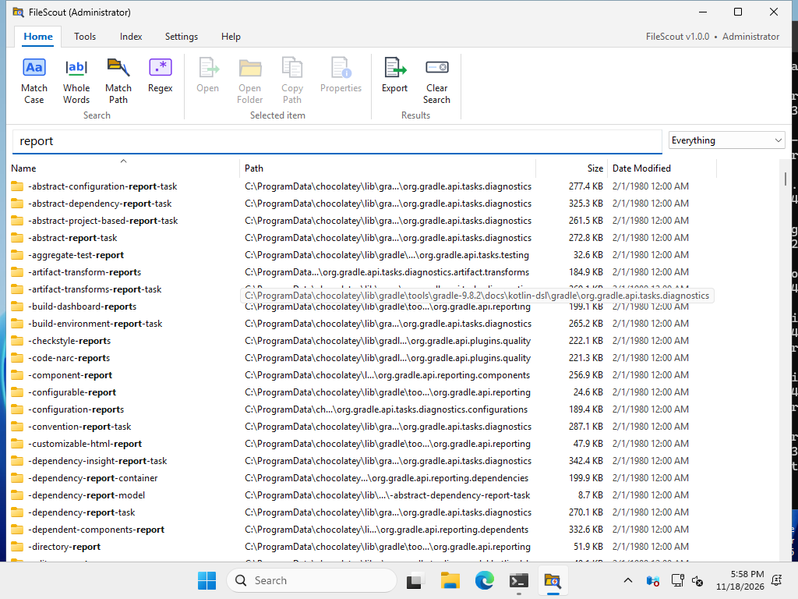
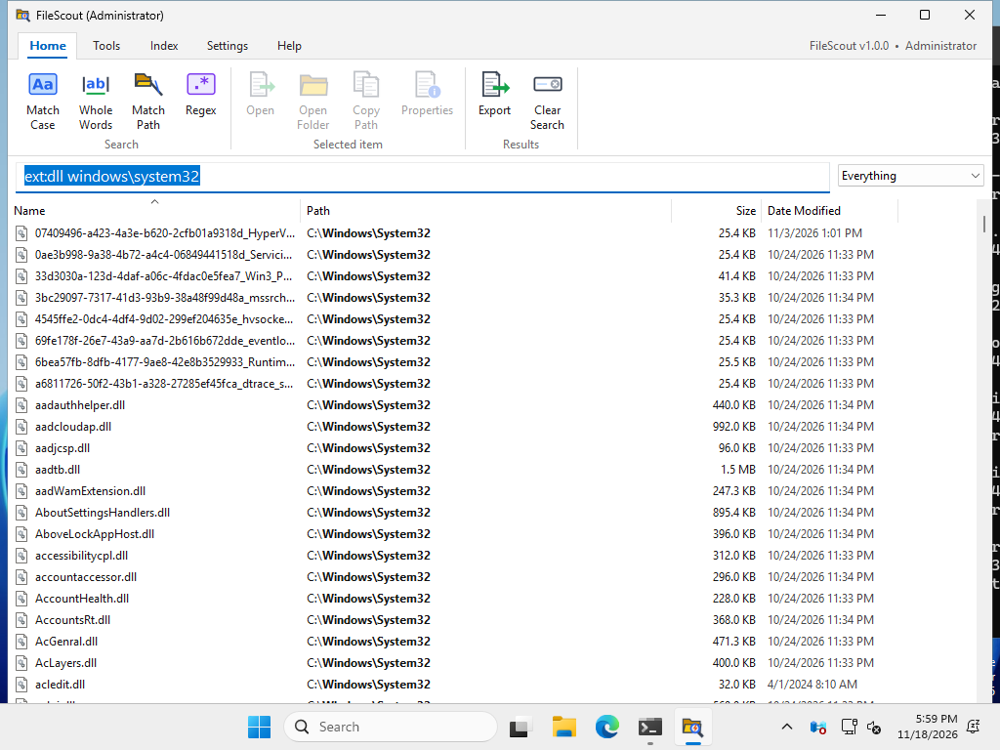
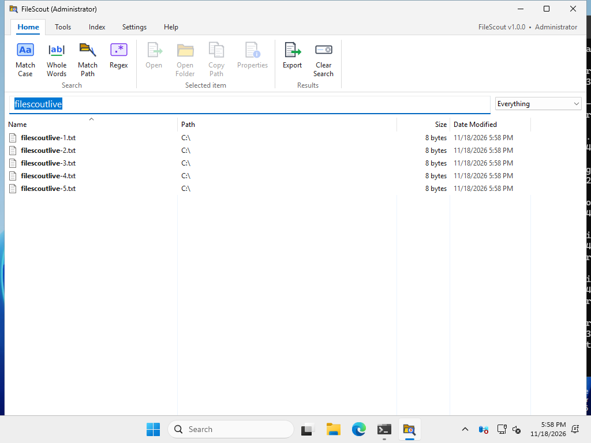
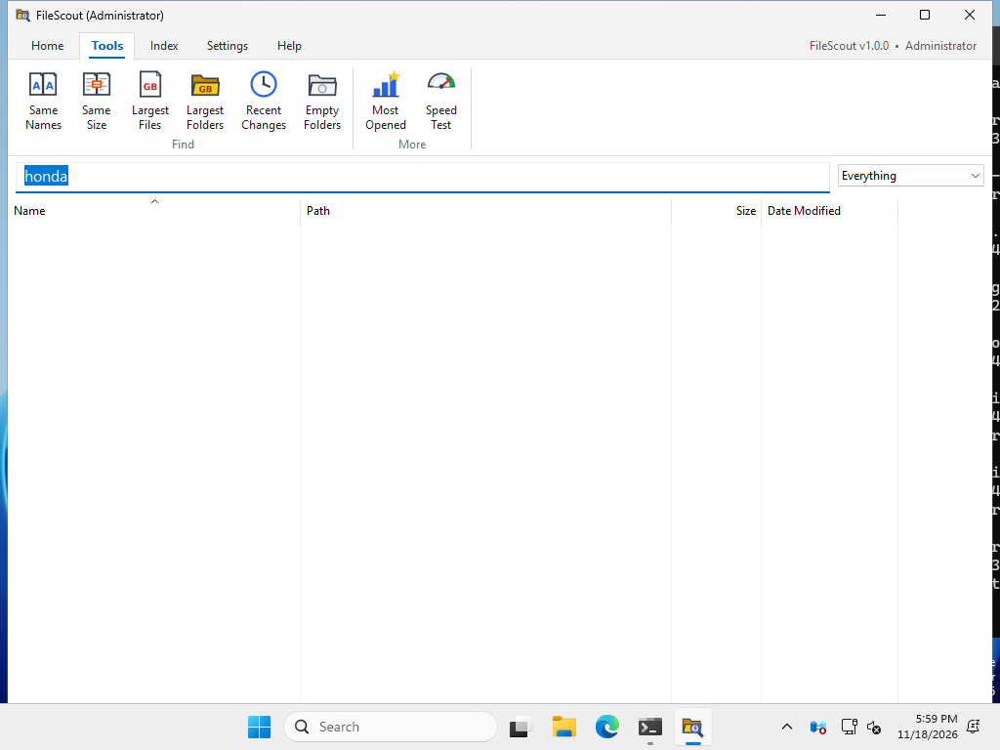
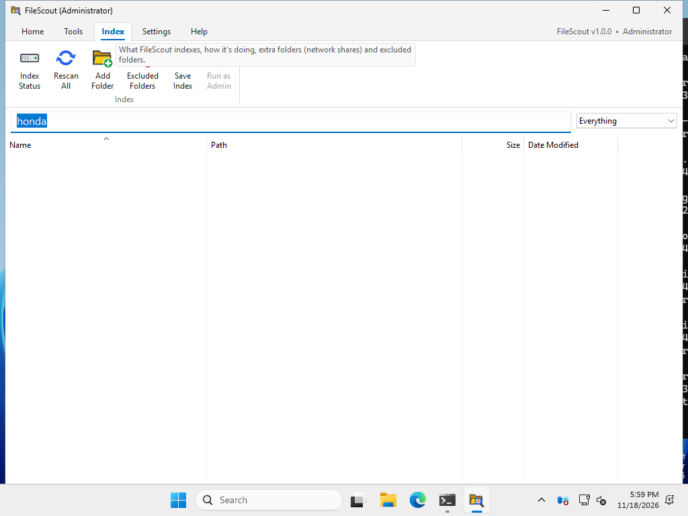
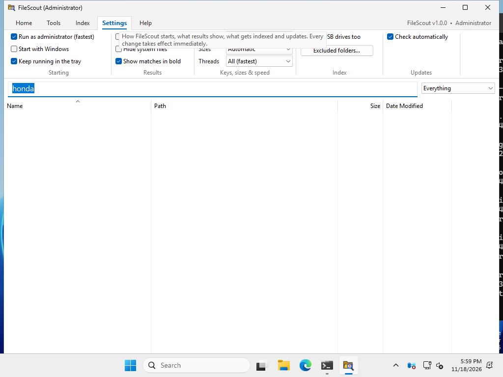

# FileScout User Guide

**FileScout finds any file or folder on your PC by name, instantly, as you type.** It's one small program (FileScout.exe) with nothing to install. It keeps a list (an "index") of every file on your drives and keeps it up to date by itself, all the time.

FileScout works like voidtools' *Everything*, and understands the same search tricks, but it's built to be faster:

- It reads each drive's file table with **several threads at once**.
- Every search uses **all of your PC's CPU threads**.
- It notices new, renamed and deleted files **4 times a second**.
- It shows the total size of **every folder**.

---

## 1. Getting started

1. Download **FileScout.exe** from the [download page](https://github.com/Dialsoft/filescout-releases) and put it anywhere you like, for example on your Desktop or in `C:\Tools`.
2. Double-click it. Windows asks **"Do you want to allow this app to make changes?"**. Click **Yes**.
   - With administrator rights, FileScout reads each NTFS drive's file table directly. A drive with a million files takes a few seconds.
   - If you click **No**, FileScout still works. It scans folders instead (slower the first time) and shows a yellow bar offering to restart as administrator.
3. Start typing. That's it.

The first start builds the index. After that, FileScout saves it when it closes, so the next start is instant: it loads in a fraction of a second and only reads what changed while it was closed.

## 2. Searching

- **Just type.** Results appear as you type. There's no Search button and nothing to wait for.
- **Several words** find names that contain *all* of them, in any order: `honda invoice 2025`
- The words you typed are shown **in bold** in each result, so you can see why it matched.
- **Down arrow** or **Page Down** jumps into the results. **Enter** opens the selected result (or the first one). **Ctrl+Enter** opens the folder it's in.
- **Esc** empties the search box. With nothing typed, every file and folder is listed.
- The **Filter** list (right of the search box) narrows results to Files, Folders, Pictures, Video (including MOBOTIX .mxg), Audio, Documents, Compressed archives or Programs.

### Search tricks

These work exactly like Everything's. Help tab > **Search Tricks** has the full list.

| Type this | To find |
|---|---|
| `report 2025` | names with both words |
| `jpg\|png` | either word (OR) |
| `!temp` | leave out names containing "temp" |
| `"tax return"` | the exact phrase, space included |
| `*.pdf` or `ext:pdf` | every PDF |
| `ext:jpg;png;heic` | any of these extensions |
| `users\marc\` | anything under that path (a `\` searches the whole path) |
| `size:>1gb`, `size:10mb..100mb`, `size:huge` | by size |
| `dm:today`, `dm:last7days`, `dm:2025`, `dm:>=1/1/2025` | by date modified (`dc:` = date created) |
| `file:` / `folder:` | only files / only folders |
| `parent:C:\Users\Marc` | only things directly inside that folder |
| `dupe:` | names that appear more than once |
| `sizedupe:` | files whose exact size appears more than once (likely copies) |
| `empty:` | folders with nothing inside |
| `case:CDK`, `ww:form`, `regex:^IMG_\d{4}` | per-word switches |

The **Home** tab has switches that apply to the whole search: **Match Case**, **Whole Words**, **Match Path** and **Regex**.

## 3. Working with results

- **Sort**: click a column heading. Click it again to reverse the order. Right-click a heading to show or hide columns (Date Created, Type, Attributes, Run Count).
- **Open**: double-click or press Enter. Every opening is counted, and Tools tab > **Most Opened** sorts the things you use most to the top.
- **Right-click** gives Windows' usual menu (Open with, Send to, Share, 7-Zip and so on) plus **Copy full path** and **Copy name**.
- **Drag** results straight into File Explorer, an email or onto the Desktop.
- **Ctrl+C** copies the files (paste them in Explorer). **Ctrl+Shift+C** copies their full paths as text.
- **Del** sends the selected items to the Recycle Bin (Windows asks first). **Alt+Enter** shows Properties.
- **Folder sizes** are always shown: the total of everything inside the folder.
- **The list stays live.** Files that are created, renamed or deleted appear and disappear within about a quarter of a second, without losing your place.

## 4. Ready-made searches (Tools tab)

| Button | What it shows |
|---|---|
| **Same Names** | files and folders whose name appears more than once |
| **Same Size** | files with exactly the same size, which are likely copies (sorted by size) |
| **Largest Files** | only files, biggest first |
| **Largest Folders** | only folders, biggest first |
| **Recent Changes** | everything changed in the last 24 hours, newest first (keeps updating) |
| **Empty Folders** | folders with nothing in them |
| **Most Opened** | sorts by how often you opened each item from FileScout |
| **Speed Test** | times typical searches with 1 thread and with all threads |

## 5. The index (Index tab)

- **Index Status** lists every indexed drive and folder: how it was indexed, how many files it has, how long it took, and whether it's being watched for changes.
- **Rescan All** rebuilds the index from scratch. You normally never need it.
- **Add Folder** indexes a network share (`\\server\share`) or a folder on a drive that isn't indexed. It's scanned, then watched for changes.
- **Excluded Folders** hides folders you never want in results (for example `C:\Windows\WinSxS`). Nothing is deleted.
- **Save Index** saves the index now. FileScout also saves it automatically when it closes and every 30 minutes.
- **Run as Admin** restarts FileScout with administrator rights, for the fast NTFS method.

## 6. Settings

Every setting takes effect immediately. Hover over any of them for a detailed explanation.

- **Run as administrator (fastest)**: asks for administrator rights at start, for the instant NTFS method.
- **Start with Windows**: starts FileScout quietly in the tray at sign-in. With administrator rights on, it sets itself up so there's no permission box at sign-in.
- **Keep running in the tray**: the X hides FileScout to the tray (near the clock) so the index stays live. Right-click the tray icon > **Exit** to quit.
- **Hotkey**: brings FileScout up from anywhere. The default is **Ctrl+Alt+F**.
- **Hide hidden files / Hide system files**, **Show matches in bold**, **Sizes** (Automatic, KB or exact bytes), **Threads** (how many CPU threads a search uses).
- **Index USB drives too**, **Excluded folders**, **Check automatically** for updates.

## 7. Updates

FileScout checks for a new version when it starts and every 6 hours after. When one is ready, a yellow bar appears with **Update now**. FileScout downloads the new version and checks it (SHA-256 fingerprint and version), swaps it in and restarts in a few seconds, keeping your settings, your index and your search.

## 8. Keyboard shortcuts

| Keys | Does |
|---|---|
| Ctrl+Alt+F (from anywhere) | bring FileScout up (hide it again if it's in front) |
| Ctrl+F or F3 | jump to the search box |
| Enter / Ctrl+Enter / Alt+Enter | open / open folder / properties |
| Ctrl+C / Ctrl+Shift+C | copy files / copy paths |
| Del / Shift+Del | Recycle Bin / delete permanently (Windows asks first) |
| Ctrl+I / Ctrl+B / Ctrl+U / Ctrl+R | Match Case / Whole Words / Match Path / Regex |
| Ctrl+S | export the results (CSV, TXT or Everything's EFU list) |
| F5 | search again |
| F1 | How to Use |
| Esc | clear the search, or hide FileScout when it's empty |

## 9. Where FileScout keeps things

- **Settings**: in the registry, under `HKEY_CURRENT_USER\Software\Dialsoft\FileScout`.
- **The saved index**: `%LOCALAPPDATA%\Dialsoft\FileScout\FileScout.db`. It holds names, sizes and dates only, never file contents.
- FileScout never sends anything anywhere. The only time it uses the internet is to check GitHub for updates.

---
© 2026 Dialsoft LLC, Marc Frega, Wharton NJ. Built with Claude by Anthropic.
